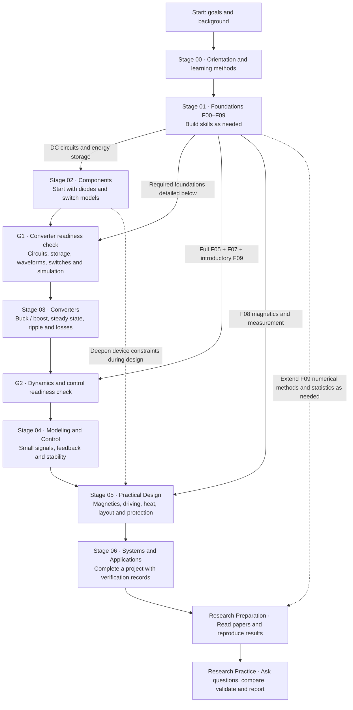
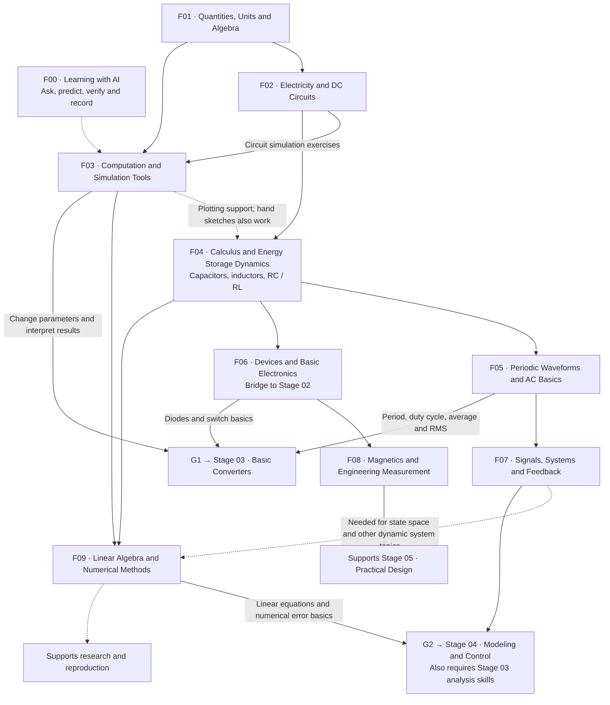

# AIPE Academy

**English** | [简体中文](README.zh-CN.md)

AIPE Academy is an open-source, AI-native learning platform for **Electrical Power and Energy Engineering**: Foundations, Power Electronics, Power Systems and Renewable Energy. One knowledge base, maintained here, is served through three interfaces: this repository, the [AIPE website](https://aipel.co.uk/academy/) and AI coding agents (a Codex skill and a Claude Code plugin). The goal is that a learner with a computer, curiosity and an AI assistant can move from zero background to genuine engineering capability through guided study, reproducible calculations and simulations.

v0.2 adds the four-domain knowledge architecture, a verified [MIT OpenCourseWare academic baseline](references/mit-ocw-baseline.md), one complete reference lesson with a Python lab per domain, and the `aipe-academy` agent integration. MIT OpenCourseWare is an external resource; AIPE Academy is not affiliated with or endorsed by MIT.

## Start learning

| Interface | Do this |
| --- | --- |
| **Claude Code** | `/plugin install aipe-academy --marketplace FulongLi/AIPE-Academy`, then `/aipe-academy:learn` or simply "Teach me electrical engineering from the beginning." |
| **Codex** | `git clone https://github.com/FulongLi/AIPE-Academy`, open the folder in Codex, type `$aipe-academy` or say "Guide me through AIPE Academy from the beginning." |
| **Any AI assistant** | Share this repository link and say "Guide me through AIPE Academy from the beginning." The assistant reads [START-HERE.md](START-HERE.md) and the [tutor workflow](prompts/tutor-guide.md). |
| **Website** | Browse the four domains, the knowledge graph and the lessons at <https://aipel.co.uk/academy/>. |

The tutor finds your starting point with short diagnostic tasks, teaches intuition before equations, runs reproducible labs with you, checks understanding progressively and keeps your progress in a local `learning/` folder that is never committed. Installation details and what has been tested: [docs/plugin-installation.md](docs/plugin-installation.md).

## Four knowledge domains

The canonical hierarchy is **Domain → Track → Module → Lesson → Lab** ([curriculum/taxonomy.json](curriculum/taxonomy.json), 57 modules). Prerequisites cross domains: the Buck converter builds on DC circuits and energy storage, power flow on AC circuits and complex power, solar inverters on power electronics and power systems.

| Domain | Tracks | Complete reference lesson (v0.2) | Lab |
| --- | --- | --- | --- |
| **Foundations** | learning with AI, mathematics, physics, circuits, electronics, signals and control, computation, magnetism and measurement (F00–F09 preserved) | [DC circuit fundamentals](curriculum/foundations/circuits/dc-circuit-fundamentals.md) · Chinese: [第一节](curriculum/01-foundations/first-lesson.zh-CN.md) | `labs/foundations/dc_circuits.py` |
| **Power Electronics** | devices and components, DC/DC conversion, AC/DC and DC/AC, isolated and resonant, losses and thermal, modelling and control, magnetics design, practical design, systems | [Buck converter fundamentals](curriculum/power-electronics/dc-dc-conversion/buck-converter-fundamentals.md) → [open Buck lab](curriculum/03-converters/buck-open-lab.md) → [Buck design tutorial](curriculum/03-converters/buck-converter.md) | `labs/buck_open.py`, `labs/power-electronics/buck_switching.py` |
| **Power Systems** | AC power networks, transformers and machines, power flow / faults / protection, stability and grid control, modern converter-dominated grids | [Three-phase system fundamentals](curriculum/power-systems/ac-power-networks/three-phase-fundamentals.md) | `labs/power-systems/three_phase.py` |
| **Renewable Energy** | solar photovoltaics, wind, energy storage, energy conversion, grid integration and systems | [Solar PV fundamentals](curriculum/renewable-energy/solar-photovoltaics/solar-pv-fundamentals.md) | `labs/renewable-energy/pv_model.py` |

Every complete lesson follows the same thirteen-section format ([template](templates/lesson-template.md)): learning objectives, prerequisites, physical intuition, principles, derivations, worked examples, a numerical or simulation lab, parameter exploration, misconceptions, AI tutor exercises, knowledge assessment, academic references and further learning. Most other modules are outlines or planned; the catalogue says which ([generated/lessons.json](generated/lessons.json), [generated/knowledge-graph.json](generated/knowledge-graph.json)).

## Reproducible labs

All labs use Python 3.10+ and the standard library (matplotlib only behind an optional `--plot` flag). Each prints JSON with units, states its assumptions and limits, and rejects invalid inputs. They are analytical or numerical teaching models, not validated hardware.

```sh
python labs/foundations/dc_circuits.py                 # Ohm's law, power and energy, dividers, nodal analysis
python labs/buck_open.py                               # ideal CCM buck: duty, current, ripple
python labs/power-electronics/buck_switching.py        # time-domain switching simulation, CCM/DCM detection
python labs/power-systems/three_phase.py               # balanced three-phase power, PF correction, per-unit
python labs/renewable-energy/pv_model.py --mppt        # single-diode PV module, MPP, irradiance/temperature, P&O
```

## Academic baseline: MIT OpenCourseWare

Twenty-two MIT OCW courses were reviewed as the scope-and-depth baseline (verified against the live site on 2026-10-20, status recorded per course): [mit-ocw-baseline.md](references/mit-ocw-baseline.md), [mit-ocw-catalogue.json](references/mit-ocw-catalogue.json), the [academic coverage map](references/academic-coverage-map.md) (MIT course → MIT topic → AIPE module → AIPE lesson, with gaps) and the [academic source guidelines](references/academic-source-guidelines.md). MIT 6.622 (Spring 2023) is the principal power-electronics benchmark; 6.334 (2007) is kept as a historical complement. AIPE Academy links to official MIT pages and records metadata only; all explanations, derivations, exercises and code here are original.

## Learning paths

Domains and modules describe *what* exists; learning paths describe *in what order* to study. The original seven-stage power-electronics path (Orientation → Foundations → Components → Converters → Modelling and Control → Practical Design → Systems) with its G1/G2/G3 readiness checks is preserved as `power-electronics-core`, and entry paths exist for the other three domains ([curriculum/taxonomy.json](curriculum/taxonomy.json), `learning_paths`). The diagrams below show the power-electronics path and the Foundations dependencies.

### 1. The power-electronics path: from orientation to research



**You do not need to finish every foundation module before starting a project.** Once you meet G1, begin buck / boost analysis. Add G2 foundations when approaching control, then deepen magnetics, measurement and numerical methods during design and research.

### 2. Foundation dependencies

F00–F09 are the modules of the Foundations domain (`f.learning-with-ai`, `f.quantities`, `f.dc-circuits`, `f.computation`, `f.calculus`/`f.dynamics`, `f.ac`, `f.electronics`, `f.signals`, `f.magnetism`, `f.linear-algebra`). Solid arrows are required knowledge; dashed arrows are supporting study.



| Module | What you learn | Evidence of learning |
|---|---|---|
| **F00 Learning with AI** | Ordinary-language questions, predictions, verification and records | Describe a gap and explain a learning result in your own words |
| **F01 Quantities, Units and Algebra** | Ratios, unit conversions, equations and graphs | Distinguish W from Wh and check orders of magnitude |
| **F02 Electricity and DC Circuits** | Voltage, current, power, series/parallel circuits, KCL/KVL and equivalents | Explain why a voltage divider changes when loaded |
| **F03 Computation and Simulation Tools** | Variables, functions, plots, models and parameter sweeps | Change one parameter, interpret results and state model assumptions |
| **F04 Calculus and Energy Storage Dynamics** | Slopes, areas, exponentials, differential equations and RC/RL responses | Predict capacitor voltage, inductor current and time constants |
| **F05 Periodic Waveforms and AC Basics** | Period, duty cycle, average, RMS, phasors and impedance | Distinguish average from RMS and explain frequency effects |
| **F06 Devices and Basic Electronics** | Diodes, MOSFETs, op-amps, operating points, small signals and losses | Compare ideal and real switch behavior |
| **F07 Signals, Systems and Feedback** | Steps, frequency response, Laplace transforms, poles and Bode plots | Explain filtering, negative feedback and model limits |
| **F08 Magnetics and Engineering Measurement** | Induction, magnetic circuits, saturation, ranges, sampling, error and heat | Explain possible discrepancies between models and measurements |
| **F09 Linear Algebra and Numerical Methods** | Linear equations, matrices, state space, step size, error and basic statistics | Compare simulation settings, record errors and assess reliability |

See the [prerequisite path (in Chinese)](curriculum/01-foundations/prerequisite-path.zh-CN.md) for exercises and the G1/G2/G3 criteria, and the stage outlines under [curriculum/](curriculum/README.md). Research preparation and research practice remain a planned progression, not an implemented course.

## AI-native tutoring

The shared tutor workflow ([prompts/tutor-guide.md](prompts/tutor-guide.md)) defines seven workflows: start learning, explain a topic, learn by simulation, check understanding, continue learning, explore advanced topics, and learning records. The Codex skill and the Claude Code plugin load the same skill text ([skills/aipe-academy/SKILL.md](skills/aipe-academy/SKILL.md)) and call the same companion command, which answers curriculum questions deterministically from the generated catalogue:

```sh
python skills/aipe-academy/scripts/academy.py status
python skills/aipe-academy/scripts/academy.py onboarding --goal "solar"
python skills/aipe-academy/scripts/academy.py prerequisites buck-converter-fundamentals
python skills/aipe-academy/scripts/academy.py lab three-phase-fundamentals -- --help
python skills/aipe-academy/scripts/academy.py references --lesson solar-pv-fundamentals
```

Learning records live in `learning/progress.json` (git-ignored); `demonstrated` is recorded only for independent work. The tutor never claims to remember progress that is not in the record.

## Website

<https://aipel.co.uk/academy/> is generated from this repository at a pinned revision: lessons, the knowledge graph topics, prerequisites and the academic references all come from `generated/`. Each website lesson links its canonical Markdown source here, its lab scripts and its external academic references. See [docs/website-integration.md](docs/website-integration.md).

## Repository structure

```text
.
├── README.md · README.zh-CN.md · START-HERE.md · AGENTS.md · aipe.yaml
├── curriculum/
│   ├── taxonomy.json            Domain → Track → Module, learning paths, G1/G2/G3 gates
│   ├── catalogue.json           one record per lesson, lab, tutorial, guide or stage outline
│   ├── 00-orientation … 06-systems-and-applications/   v0.1 stage outlines and lessons (preserved)
│   ├── foundations/ · power-electronics/ · power-systems/ · renewable-energy/   v0.2 lessons
├── labs/                        standard-library Python labs (buck_open.py and labs/<domain>/)
├── references/                  MIT OCW catalogue, verification, coverage, baseline, guidelines; v0.1 reviews
├── schemas/                     lesson, taxonomy and academic-reference JSON Schemas
├── scripts/                     build_catalogue.py · build_reference_docs.py · verify_academic_sources.py
├── generated/                   lessons.json · knowledge-graph.json · academic-references.json
├── prompts/ · templates/        tutor workflow, lesson and learning-record templates
├── skills/aipe-academy/         shared Codex / Claude Code skill and companion command
├── .agents/skills/aipe-academy/ Codex repository-discovery entry
├── .claude-plugin/              Claude Code plugin and marketplace manifests
├── tests/ · .github/workflows/  offline tests, lab runs, plugin validation
└── docs/                        architecture, curriculum guide, plugin installation, website integration
```

## Development and validation

```sh
python -m pip install -r requirements-dev.txt
python scripts/build_catalogue.py --check        # taxonomy, catalogue, references, generated outputs
python scripts/build_reference_docs.py --check   # Markdown references rendered from JSON
python -m unittest discover -s tests -v          # curriculum, taxonomy, references, labs, CLI, packaging
claude plugin validate .                         # Claude Code plugin manifest (optional, needs the CLI)
python scripts/verify_academic_sources.py        # network re-verification of the MIT OCW pages (on demand)
```

Architecture and contribution details: [docs/architecture.md](docs/architecture.md), [docs/curriculum-guide.md](docs/curriculum-guide.md).

## Contributing direction

Good contributions help learners move from confusion to capability: beginner-friendly explanations, standard-format lessons for planned modules, reproducible labs and tests, translations with reviewed status, datasheet reading guides, safety notes, and tutor exercises. Follow the curriculum guide and the academic source guidelines; never copy external course material.

## License

Educational content, code and metadata in this repository are released under the Creative Commons Attribution 4.0 International licence in `LICENSE.md`. External academic references, including MIT OpenCourseWare, keep their own licences and are linked, not copied.

## Ecosystem

AIPE Academy is the education capability of the AIPE ecosystem (`aipe.yaml`). The v0.1 integration notes remain in [docs/ecosystem-v0.1.md](docs/ecosystem-v0.1.md).
