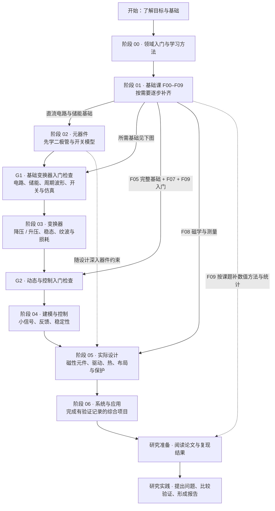
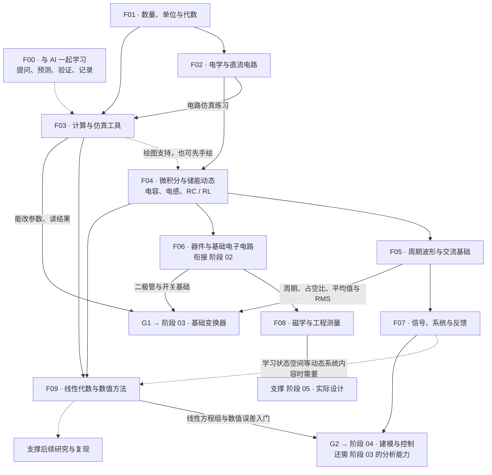

# AIPE Academy

[English](README.md) | **简体中文**

AIPE Academy 是一个面向 **电力与能源工程**（基础、电力电子、电力系统、可再生能源）的开源、AI 原生学习平台。知识库只维护一份，通过三种界面提供：本仓库、[AIPE 网站](https://aipel.co.uk/academy/)，以及 AI 编程助手（Codex 技能与 Claude Code 插件）。目标是让一个只有电脑、好奇心和 AI 助手的学习者，通过有引导的学习、可复现的计算与仿真，从零基础走向真正的工程能力。

v0.2 新增了四领域知识体系、经核实的 [MIT OpenCourseWare 学术基准](references/mit-ocw-baseline.md)、每个领域一节带 Python 实验的完整示范课，以及 `aipe-academy` 智能体集成。MIT OpenCourseWare 是外部资源，AIPE Academy 与 MIT 没有隶属关系，也未获得 MIT 认可。

## 开始学习

| 界面 | 操作 |
| --- | --- |
| **Claude Code** | 运行 `/plugin install aipe-academy --marketplace FulongLi/AIPE-Academy`，然后输入 `/aipe-academy:learn`，或直接说“请按 AIPE Academy 带我从零学习”。 |
| **Codex** | `git clone https://github.com/FulongLi/AIPE-Academy`，在 Codex 中打开该文件夹，输入 `$aipe-academy` 或说“请按 AIPE Academy 带我从零学习”。 |
| **其他 AI 助手** | 把仓库链接交给它，再说“请按 AIPE Academy 带我从零学习”。助手会阅读 [START-HERE.md](START-HERE.md) 与[导师流程](prompts/tutor-guide.md)。 |
| **网站** | 在 <https://aipel.co.uk/zh/academy/> 浏览四个学科、知识图谱与课程。 |

导师通过简短的诊断任务确定你的起点，先讲物理直觉再讲公式，和你一起运行可复现的实验，逐步检查理解，并把进度保存在本地 `learning/` 文件夹（不会被提交）。安装细节与已测试内容见 [docs/plugin-installation.md](docs/plugin-installation.md)（英文）。

## 四个知识领域

规范层级为 **领域 → 方向 → 模块 → 课程 → 实验**（[curriculum/taxonomy.json](curriculum/taxonomy.json)，57 个模块）。先修关系跨领域：Buck 变换器建立在直流电路与储能元件之上，潮流计算建立在交流电路与复功率之上，光伏逆变器建立在电力电子与电力系统之上。

| 领域 | 方向 | 完整示范课（v0.2） | 实验 |
| --- | --- | --- | --- |
| **基础** | 与 AI 一起学习、工程数学、物理、电路、电子学、信号与控制、计算、磁学与测量（保留 F00–F09） | [DC circuit fundamentals](curriculum/foundations/circuits/dc-circuit-fundamentals.md)（英文）· 中文：[第一节：一个简单电路用了多少电？](curriculum/01-foundations/first-lesson.zh-CN.md) | `labs/foundations/dc_circuits.py` |
| **电力电子** | 器件与元件、DC/DC 变换、整流与逆变、隔离与谐振、损耗与热、建模与控制、磁性元件设计、工程实践、系统 | [Buck converter fundamentals](curriculum/power-electronics/dc-dc-conversion/buck-converter-fundamentals.md) → [开放 Buck 实验](curriculum/03-converters/buck-open-lab.md) → [Buck 设计教程](curriculum/03-converters/buck-converter.md) | `labs/buck_open.py`、`labs/power-electronics/buck_switching.py` |
| **电力系统** | 交流电力网络、变压器与电机、潮流/故障/保护、稳定性与电网控制、变换器主导的现代电网 | [Three-phase system fundamentals](curriculum/power-systems/ac-power-networks/three-phase-fundamentals.md) | `labs/power-systems/three_phase.py` |
| **可再生能源** | 光伏、风能、储能、能量转换、并网与能源系统 | [Solar PV fundamentals](curriculum/renewable-energy/solar-photovoltaics/solar-pv-fundamentals.md) | `labs/renewable-energy/pv_model.py` |

每节完整课程遵循同一套十三段式格式（[模板](templates/lesson-template.md)）：学习目标、先修、物理直觉、基本原理、数学推导、例题、数值或仿真实验、参数探索、常见误区、AI 导师练习、知识检测、学术参考、延伸学习。其余多数模块仍是大纲或规划中，目录会如实标注（[generated/lessons.json](generated/lessons.json)、[generated/knowledge-graph.json](generated/knowledge-graph.json)）。中文课程目前以基础领域为主，新课程的中文版本将在审核后另行发布，不会把机器翻译标为已审核。

## 可复现的实验

所有实验基于 Python 3.10+ 标准库（matplotlib 仅在可选的 `--plot` 下使用）。每个脚本输出带单位的 JSON，说明假设与模型局限，并拒绝无效输入。它们是解析或数值教学模型，不是经过验证的硬件性能。

```sh
python labs/foundations/dc_circuits.py                 # 欧姆定律、功率与能量、分压器、节点分析
python labs/buck_open.py                               # 理想 CCM Buck：占空比、电流、纹波
python labs/power-electronics/buck_switching.py        # 时域开关仿真，自动判别 CCM/DCM
python labs/power-systems/three_phase.py               # 对称三相功率、功率因数校正、标幺值
python labs/renewable-energy/pv_model.py --mppt        # 单二极管光伏组件模型、MPP、辐照/温度、扰动观察法
```

## 学术基准：MIT OpenCourseWare

22 门 MIT OCW 课程被作为学术范围与深度的基准进行了审查（2026-10-20 对照官方网站逐一核实，状态逐门记录）：[mit-ocw-baseline.md](references/mit-ocw-baseline.md)、[mit-ocw-catalogue.json](references/mit-ocw-catalogue.json)、[学术覆盖映射](references/academic-coverage-map.md)（MIT 课程 → MIT 主题 → AIPE 模块 → AIPE 课程，并标出缺口）以及[学术来源准则](references/academic-source-guidelines.md)。MIT 6.622（2023 春）是电力电子的首要基准，6.334（2007）作为历史补充保留。AIPE Academy 只链接 MIT 官方页面并记录元数据；这里所有讲解、推导、练习与代码均为原创。

## 学习路线

领域与模块描述“有什么”，学习路线描述“按什么顺序学”。原有的电力电子七阶段路线（入门 → 基础 → 元器件 → 变换器 → 建模与控制 → 实际设计 → 系统应用）及其 G1/G2/G3 准备度检查完整保留为 `power-electronics-core`，另外三个领域各有入门路线（见 [curriculum/taxonomy.json](curriculum/taxonomy.json) 的 `learning_paths`）。下图展示电力电子主线与基础课依赖关系。

### 1. 电力电子路线：从入门到研究



**不用先学完所有基础课才开始做项目。** 完成 G1 所需的基础后就可以开始 Buck / Boost；学习动态控制时再补 G2，工程设计和研究阶段继续补磁学、测量与数值方法。

### 2. 基础课展开

F00–F09 是基础领域的模块（`f.learning-with-ai`、`f.quantities`、`f.dc-circuits`、`f.computation`、`f.calculus`/`f.dynamics`、`f.ac`、`f.electronics`、`f.signals`、`f.magnetism`、`f.linear-algebra`）。实线表示进入后续内容需要的基础；虚线表示可穿插学习的支持内容。



| 模块 | 学什么 | 完成时的能力证据 |
|---|---|---|
| **F00 与 AI 一起学习** | 普通语言提问、预测、验证和学习记录 | 能说清哪里不懂，并复述一次学习结果 |
| **F01 数量、单位与代数** | 比例、单位换算、方程和读图 | 能区分 W / Wh，计算并检查数量级 |
| **F02 电学与直流电路** | 电压、电流、功率、串并联、KCL/KVL、等效电路 | 能解释分压器接负载后为什么变化 |
| **F03 计算与仿真工具** | 变量、函数、绘图、模型与参数扫描 | 能改变一个参数并读出结果，说明模型假设 |
| **F04 微积分与储能动态** | 斜率、面积、指数、微分方程、RC/RL 响应 | 能预测电容电压、电感电流与时间常数 |
| **F05 周期波形与交流基础** | 周期、占空比、平均值、RMS、相量与阻抗 | 能区分平均值与 RMS，解释不同频率的影响 |
| **F06 器件与基础电子电路** | 二极管、MOSFET、运放、工作点、小信号和损耗 | 能比较理想开关和实际开关的行为 |
| **F07 信号、系统与反馈** | 阶跃、频率响应、拉普拉斯变换、极点、Bode 图 | 能解释滤波与负反馈，识别模型适用范围 |
| **F08 磁学与工程测量** | 感应、磁路、饱和、量程、采样、误差与热 | 能说明模型与测量不一致的可能原因 |
| **F09 线性代数与数值方法** | 方程组、矩阵、状态空间、步长、误差与统计入门 | 能比较仿真设置，记录误差并判断结论是否可靠 |

更详细的练习和 G1/G2/G3 掌握标准见[先修路线](curriculum/01-foundations/prerequisite-path.zh-CN.md)，各阶段大纲见 [curriculum/](curriculum/README.md)。研究准备与研究实践仍是规划中的递进，不是已建成的课程。

## AI 原生辅导

共享的导师流程（[prompts/tutor-guide.md](prompts/tutor-guide.md)）定义了七个工作流：开始学习、讲解主题、通过仿真学习、检查理解、继续学习、探索进阶主题、学习记录。Codex 技能与 Claude Code 插件加载同一份技能文本（[skills/aipe-academy/SKILL.md](skills/aipe-academy/SKILL.md)），调用同一个配套命令，从生成的目录中确定性地回答课程问题：

```sh
python skills/aipe-academy/scripts/academy.py --language zh status
python skills/aipe-academy/scripts/academy.py onboarding --goal "光伏"
python skills/aipe-academy/scripts/academy.py prerequisites buck-converter-fundamentals
python skills/aipe-academy/scripts/academy.py lab three-phase-fundamentals -- --help
python skills/aipe-academy/scripts/academy.py references --lesson solar-pv-fundamentals
```

学习记录保存在 `learning/progress.json`（已被 Git 忽略）；只有独立完成的任务才会记为 `demonstrated`。导师不会声称记得记录中没有的进度。

## 网站

<https://aipel.co.uk/academy/> 由本仓库在固定版本上生成：课程、知识图谱主题、先修关系与学术参考全部来自 `generated/`。网站上的每节课程都链接到这里的规范 Markdown 源文件、实验脚本与外部学术参考。见 [docs/website-integration.md](docs/website-integration.md)。

## 仓库结构

```text
.
├── README.md · README.zh-CN.md · START-HERE.md · AGENTS.md · aipe.yaml
├── curriculum/
│   ├── taxonomy.json            领域 → 方向 → 模块、学习路线、G1/G2/G3 门槛
│   ├── catalogue.json           每节课程、实验、教程、指南或阶段大纲一条记录
│   ├── 00-orientation … 06-systems-and-applications/   v0.1 阶段大纲与课程（保留）
│   ├── foundations/ · power-electronics/ · power-systems/ · renewable-energy/   v0.2 课程
├── labs/                        标准库 Python 实验（buck_open.py 与 labs/<domain>/）
├── references/                  MIT OCW 目录、核实记录、覆盖映射、基准文档、来源准则；v0.1 调研
├── schemas/                     课程、知识体系与学术参考的 JSON Schema
├── scripts/                     build_catalogue.py · build_reference_docs.py · verify_academic_sources.py
├── generated/                   lessons.json · knowledge-graph.json · academic-references.json
├── prompts/ · templates/        导师流程、课程与学习记录模板
├── skills/aipe-academy/         Codex / Claude Code 共享技能与配套命令
├── .agents/skills/aipe-academy/ Codex 仓库内发现入口
├── .claude-plugin/              Claude Code 插件与市场清单
├── tests/ · .github/workflows/  离线测试、实验运行、插件校验
└── docs/                        架构、课程编写指南、插件安装、网站集成
```

## 开发与验证

```sh
python -m pip install -r requirements-dev.txt
python scripts/build_catalogue.py --check        # 知识体系、目录、学术参考、生成文件
python scripts/build_reference_docs.py --check   # 由 JSON 渲染的 Markdown 参考文档
python -m unittest discover -s tests -v          # 课程、知识体系、参考、实验、命令行、打包
claude plugin validate .                         # Claude Code 插件清单（可选，需要其 CLI）
python scripts/verify_academic_sources.py        # 按需联网重新核实 MIT OCW 页面
```

架构与贡献细节：[docs/architecture.md](docs/architecture.md)、[docs/curriculum-guide.md](docs/curriculum-guide.md)。

## 贡献方向

好的贡献应帮助学习者从困惑走向能力：对初学者友好的讲解、面向规划中模块的标准格式课程、可复现的实验与测试、带审核状态的翻译、数据手册阅读指南、安全说明与导师练习。请遵循课程编写指南与学术来源准则，不要复制外部课程材料。

## 许可证

本仓库的教学内容、代码与元数据以 `LICENSE.md` 中的知识共享署名 4.0 国际许可证（CC BY 4.0）发布。包括 MIT OpenCourseWare 在内的外部学术参考保留其自身许可，只链接不复制。

## 生态

AIPE Academy 是 AIPE 生态中的教育能力（`aipe.yaml`）。v0.1 的集成说明保留在 [docs/ecosystem-v0.1.md](docs/ecosystem-v0.1.md)。
