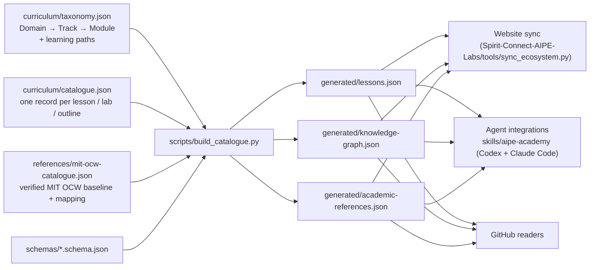

# AIPE Academy architecture (v0.2)

AIPE Academy is the canonical, machine-readable source of educational knowledge
for **AI for Power Engineering**. One knowledge base is served through three
interfaces: this GitHub repository, the AIPE website
(<https://aipel.co.uk/academy/>) and AI agents (a Codex skill and a Claude Code
plugin). Everything the other interfaces show is generated from files reviewed
in this repository.



## 1. Three dimensions, kept apart

| Dimension | What it answers | Where it lives |
| --- | --- | --- |
| **Academic domain** | Which discipline does this belong to? | `taxonomy.domains`: `foundations`, `power-electronics`, `power-systems`, `renewable-energy` |
| **Knowledge taxonomy** | What is the concept and what does it depend on? | `taxonomy.tracks` and `taxonomy.modules` (ids such as `pe.buck`), with `requires` (prerequisite edges, acyclic, cross-domain allowed) and `related` |
| **Learning progression** | In what order should a learner meet it? | `taxonomy.learning_paths`: the preserved seven-stage power-electronics path with the G1/G2/G3 gates, plus entry paths for the other domains |

A learner can browse the taxonomy or follow a path; the website and the agents
present both. Stages are never domains.

## 2. Content hierarchy

```text
Domain (4)
└── Track (26)
    └── Module (57)            knowledge node; status derived from attached lessons
        └── Lesson / lab / tutorial / guide / stage outline   (curriculum/catalogue.json)
            └── Lab script    (labs/**/*.py, standard-library Python)
```

- A lesson record names its `domain`, `track`, `module` and optionally the
  further modules it `covers`; the build checks that the module belongs to the
  track and the track to the domain.
- Module status is derived, never typed: `available` if any attached lesson is
  available, else `draft`, else `outline`, else `planned` (no lesson).
- Lesson records carry a `concept` key shared by translations of the same
  knowledge unit; the build publishes `translations` per lesson and rejects two
  records in the same language for one concept. `translation_status` says
  whether a translation was reviewed; machine translations are never marked
  reviewed.
- `format: aipe-lesson-v2` marks a lesson that follows the thirteen-section
  standard format; the build verifies the sections.
- `academic_references` are ids of verified reference records; the build
  verifies the lesson text links each official URL.

## 3. Stable identifiers and URLs

- Lesson URL: `/academy/<domain>/<slug>/`. Slugs are globally unique and never
  depend on folder layout, so files can move without breaking links.
- All eleven v0.1 URLs are unchanged; `tests/test_curriculum.py` pins them.
- Module ids are shared by the website knowledge graph, the agents and the
  coverage map. The website previously used these ids for its own graph; v0.2
  makes the Academy the source and the website a consumer.
- Website compatibility: the website's former `renewables` subject key is now
  `renewable-energy`; the old URLs redirect (website `legacy/`).

## 4. Files and ownership

| Path | Owner | Notes |
| --- | --- | --- |
| `curriculum/00-orientation` … `06-systems-and-applications` | content | v0.1 stage folders, preserved; `taxonomy.domains[].legacy_stages` maps them to domains |
| `curriculum/foundations`, `curriculum/power-electronics`, `curriculum/power-systems`, `curriculum/renewable-energy` | content | v0.2 domain/track folders for new lessons |
| `curriculum/taxonomy.json`, `curriculum/catalogue.json` | metadata | hand-maintained, schema-validated |
| `labs/` | code | `labs/buck_open.py` (v0.1) and `labs/<domain>/*.py` (v0.2); standard library; optional matplotlib |
| `references/` | references | `mit-ocw-catalogue.json` (source of truth), `mit-ocw-verification.json` (last network check), `mit-ocw-coverage.json` (topic outlines and mapping evidence), generated `mit-ocw-baseline.md` and `academic-coverage-map.md`, `academic-source-guidelines.md`, plus the v0.1 Erickson/undergraduate reviews |
| `schemas/` | metadata | lesson, taxonomy and academic-reference JSON Schemas |
| `scripts/` | tooling | `build_catalogue.py` (offline, deterministic), `build_reference_docs.py` (renders the two Markdown references), `verify_academic_sources.py` (network, on demand) |
| `generated/` | generated | the three public outputs; CI fails if stale |
| `prompts/`, `templates/` | tutoring | `tutor-guide.md` (shared teaching workflow), lesson and learning-record templates |
| `skills/aipe-academy/` | agents | shared skill: `SKILL.md`, `scripts/academy.py`, `references/commands.md`, `agents/openai.yaml` |
| `.agents/skills/aipe-academy/` | agents | Codex repository-discovery entry pointing at the shared skill |
| `.claude-plugin/` | agents | Claude Code `plugin.json` and `marketplace.json`; the plugin root is the repository |
| `tests/`, `.github/workflows/validate.yml` | quality | offline tests, lab runs, companion-command smoke tests, `claude plugin validate` |
| `learning/` | learner | local, git-ignored progress records |

## 5. Build and validation pipeline

```sh
python -m pip install -r requirements-dev.txt
python scripts/build_catalogue.py            # validate + regenerate generated/*
python scripts/build_reference_docs.py       # render references/*.md from JSON
python scripts/build_catalogue.py --check    # CI: generated files must be current
python -m unittest discover -s tests -v      # curriculum, taxonomy, references, labs, CLI, packaging
python scripts/verify_academic_sources.py    # network: re-verify the MIT OCW pages (on demand)
```

The build rejects unresolved ids, prerequisite cycles (lessons and modules),
unsafe or missing paths, duplicate slugs or concepts per language, mandatory
proprietary tools, missing lab scripts, unlinked academic references and
non-conforming standard-format lessons. Hashes use UTF-8/LF so Windows and
Linux agree.

## 6. Agent integrations

Both platforms load the same skill text and call the same companion command:

```text
skills/aipe-academy/SKILL.md            shared instructions (Agent Skills standard fields only)
skills/aipe-academy/scripts/academy.py  deterministic answers from generated/* and the local record
prompts/tutor-guide.md                  the seven tutoring workflows
```

- **Claude Code**: `.claude-plugin/plugin.json` names the plugin `aipe-academy`;
  the default `skills/` scan loads the shared skill as `/aipe-academy:aipe-academy`,
  and four thin commands (`/aipe-academy:learn`, `:explain`, `:lab`,
  `:references`) delegate to it. `.claude-plugin/marketplace.json` lets users
  install straight from this repository.
- **Codex**: `.agents/skills/aipe-academy/SKILL.md` is discovered when the
  repository is the working directory; it points to the shared skill. The
  shared skill folder can also be installed standalone under `~/.agents/skills/`.
- The companion command discovers the checkout from the plugin root, an
  environment variable or the working directory and never phones home.

## 7. Website synchronisation

The website repository pins an immutable Academy revision and regenerates its
Academy pages at build time from `generated/lessons.json`,
`generated/knowledge-graph.json` and `generated/academic-references.json`.
Lesson pages gain module, canonical-source, lab, translation and academic
reference metadata; the knowledge graph topics are the Academy modules; the
website adds only its own links per topic. See `docs/website-integration.md`.

## 8. Extending the architecture

- New lesson: write it from `templates/lesson-template.md`, add a catalogue
  record, run the build; the website and agents pick it up from the generated
  files.
- New module: add it to `taxonomy.modules` with bilingual labels and real
  prerequisites; it appears as `planned` until a lesson attaches.
- New domain: only when there is concrete content; add it to
  `taxonomy.domains`, create a track, and extend the website's stage data.
- New academic source: follow `references/academic-source-guidelines.md`.
